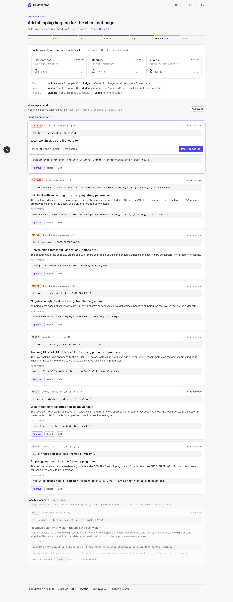
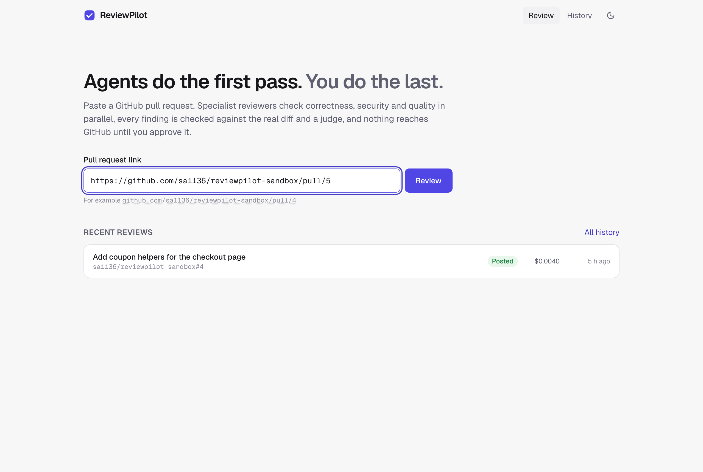
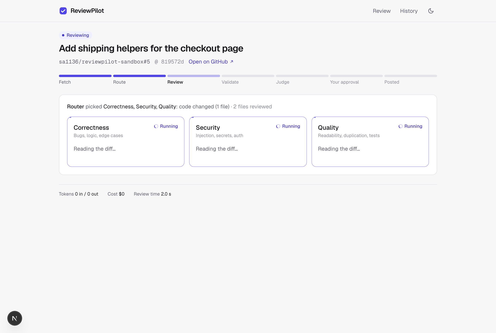
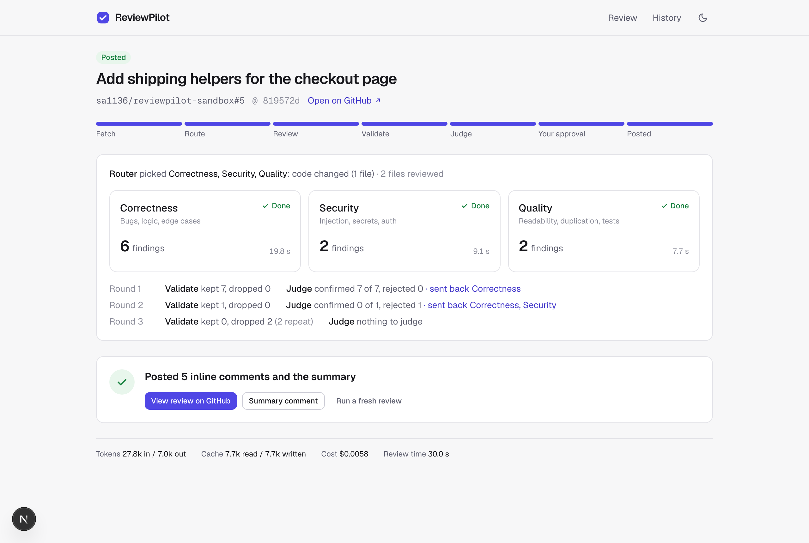

# ReviewPilot

**A code review agent that does the first pass on a pull request and lets a human make the final
call: parallel Claude reviewers, every finding checked against the real diff, nothing posted
without approval.**

Paste a GitHub PR link into the web app. A router picks which specialist reviewers apply, up to
three Claude sub agents review the diff in parallel while the UI streams their progress, plain code
throws out any finding that does not point at a real added line, a judge model confirms or rejects
the rest, and the graph pauses so you can approve, edit or reject each comment before anything
reaches GitHub.

On 10 unseen planted bug PRs it caught **84 of 84 planted bugs over 3 runs**, at about
**$0.0024 and 11 seconds per review** ([full results](evals/RESULTS.md)).



## How it works

```
Next.js UI: paste a PR link            CLI (review, approve, --auto-approve)
                     \                  /
  fetch_pr        diff with numbered lines, skip rules (lockfiles, binaries, huge patches)
  router          plain code: which agents run, with a reason for each (docs only -> quality)
    |-- fan out in parallel (LangGraph Send) ----------------|
  correctness          security                 quality
  bugs, logic,         injection, secrets,      readability, naming,
  edge cases           auth, deserialization    duplication, missing tests
    |-- fan in --|
  validate        plain code: on an added line? evidence really in that line? in lane? dedupe
  judge (LLM)     confirm / reject / downgrade; may send an agent back with feedback
                  (default 2 retries, hard cap of 15 rounds enforced in code)
  approval        interrupt(): approve, edit, reject or promote each comment
                  checkpointer saves state (SQLite, Postgres behind a flag)
  post_review     inline comments on added lines + one sticky summary comment
```

The FastAPI backend wraps the same graph and streams its events to the browser over Server Sent
Events. Every node and model call is traced to LangSmith with pr, sha, route and round.

## 60 second demo

No API keys needed: demo mode replays a real review.

```bash
REVIEWPILOT_DEMO=1 uv run uvicorn api.main:app        # terminal 1
cd web && npm install && npm run dev                   # terminal 2, then open localhost:3000
```

1. Paste any GitHub PR link and press Review.
2. Watch the router pick agents and the three agent cards run in parallel, then validate and judge.
3. The approval panel opens: each comment shows file, line, the code, severity and a suggestion.
   Press `r` to reject a false positive, `e` to edit one, `j`/`k` to move.
4. Press Post. The posted state links to the review (demo mode records it instead of posting).
5. Open History to see the review with its counts by severity, cost and time.

| Home | Live review | Approval | Posted |
|---|---|---|---|
|  |  |  |  |

## Results (holdout PRs, never tuned on)

15 planted PRs in a [sandbox repo](https://github.com/sa1136/reviewpilot-sandbox/pulls), scored
by plain code evaluators in LangSmith, 3 repetitions each. PRs #1 and #2 were used to tune prompts,
so the table below uses only the 10 holdout PRs (#6 to #15: 7 with 3 to 5 bugs each, 3 clean;
Python, TypeScript, JavaScript and Markdown).

| Experiment | Bugs caught per run | False positives on clean PRs per run | Extra comments on buggy PRs per run | Precision | Avg cost | Avg latency |
|---|---|---|---|---|---|---|
| **A: default** (3 agents, Haiku 5.5, 2 retries) | **28 / 28 / 28 of 28** | 1 / 1 / 2 | 3 / 3 / 6 | 82% | $0.0024 | 11.1 s |
| B: 2 agents (no security agent) | 19 / 19 / 19 of 28 | 1 / 1 / 2 | 9 / 6 / 5 | 71% | $0.0025 | 15.2 s |
| C: no judge retries | 27 / 27 / 28 of 28 | 1 / 1 / 1 | 4 / 3 / 4 | 85% | $0.0023 | 10.9 s |
| D: Sonnet 5.5 for correctness | 28 / 28 / 27 of 28 | 1 / 1 / 1 | 7 / 9 / 10 | 75% | $0.0121 | 12.1 s |

B's bug count is corrected for one false match per run found in the [audit](evals/RESULTS.md) (its precision is as scored). What
it means: the security agent is worth it, retries rarely fire and cost nothing when they don't,
and Sonnet for correctness costs 5x with more noise and no recall gain, so the default is Haiku
everywhere. Routing and node trajectories were valid in 100% of runs. The clean code and docs PRs
got no comments at all; every clean PR false positive was a test coverage comment on the tests
only PR. Recall is saturated because the planted bugs are easy; see the limitations below.

## Key design decisions

* **Limits live in code, not in the prompt.** The judge's retry loop is capped at 15 rounds in the
  graph router; config can only lower it. The comment budget, severity floor (injection and
  secrets are always critical) and inline rules are plain code too.
* **Evidence validation before the judge.** A finding must point at an added line and quote code
  that is really on that line (or on consecutive added lines). Out of lane categories, repeats of
  anything already judged, and duplicates across agents are dropped with a recorded reason. This
  is what stops made up line numbers.
* **Human approval is the last gate.** The graph calls `interrupt()` before posting. Each comment
  can be approved, edited, rejected, or (for findings the judge rejected but a human may want)
  promoted. Nothing reaches GitHub without a yes.
* **Checkpointing.** Thread id `owner/repo#pr@head_sha`, so one saved review per commit. A review
  waiting for approval survives restarts, resuming needs no model credentials, and re-reviewing a
  posted commit writes nothing.
* **SSE with replay.** Every graph event is written to an append only log; the stream replays
  after `Last-Event-ID`, so a refresh or dropped connection mid review recovers exactly. The web
  UI is a pure reducer over a snapshot plus events.
* **Fail soft, be honest.** If one agent fails, the others' findings still show and the status is
  `partial`; it never claims "no issues" after a failure.

## Run it

```bash
uv sync
cp .env.example .env      # ANTHROPIC_API_KEY, GITHUB_TOKEN (pull requests read and write)
```

**CLI.** Review, decide, post:

```bash
uv run python -m reviewpilot review --repo owner/name --pr 12           # stops at approval
uv run python -m reviewpilot approve --repo owner/name --pr 12 --reject i3 --edit i2="Use >= here."
uv run python -m reviewpilot approve --repo owner/name --pr 12 --post
```

Also `review --fake` (no key, no cost), `--diff-only`, `--fresh`, `--auto-approve` (approve and
post in one go) and `approve -i` (decide item by item).

**API.** `uv run uvicorn api.main:app --reload` (docs at http://127.0.0.1:8000/docs). Start a
review with `POST /reviews`, follow it on `GET /reviews/{id}/events`, approve and post with
`POST /reviews/{id}/decisions`. `scripts/demo_api.sh <pr url>` walks through it with curl.

**Web.** `cd web && npm install && npm run dev`, with `web/.env.local` pointing at the API (see
`web/.env.example`). The Next.js server adds the API token, so it never reaches the browser.

**Demo mode.** `REVIEWPILOT_DEMO=1` on the API: fixture PR, replayed model answers, recorded
"posts". No keys, no cost.

**Evals.** Set `LANGSMITH_API_KEY` (and `LANGSMITH_TRACING=true` for traces), then:

```bash
uv run python -m evals.run dataset            # build the LangSmith dataset from the answer keys
uv run python -m evals.run estimate           # cost estimate before running anything
uv run python -m evals.run experiment A       # 15 PRs x 3 runs, never posts
uv run python -m evals.run report             # tables in evals/RESULTS.md
```

**Checks.** `uv run ruff check . && uv run ruff format --check . && uv run pytest` and
`cd web && npm run lint && npm run typecheck && npm test && npm run test:e2e`.

## Limitations

* The planted bugs are clear, single function bugs in small new files, so recall is saturated.
  Real PRs with bugs spread across modified files will score lower.
* The eval matches comments to bugs by file and line within 1, not by meaning; credited catches
  were audited by hand.
* Most false positives are plausible but unrequested input validation comments. The human
  approval step is where those get rejected today.
* Comments post as the token's user, not a bot, and the deployed setup (Postgres, hosting) is not
  done yet.

## Next steps

* A harder eval set: subtler bugs, modified files in a larger codebase, multi file bugs.
* GitHub Action auto mode, a GitHub App for a bot identity, and a hosted deploy (Vercel, a hosted
  API and Postgres).
* Use the approval data (approve and edit rates per agent) to tune what the judge lets through.
